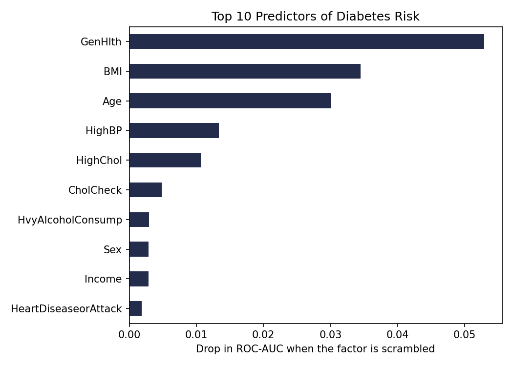
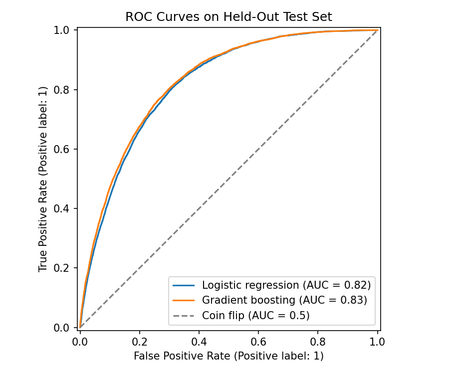
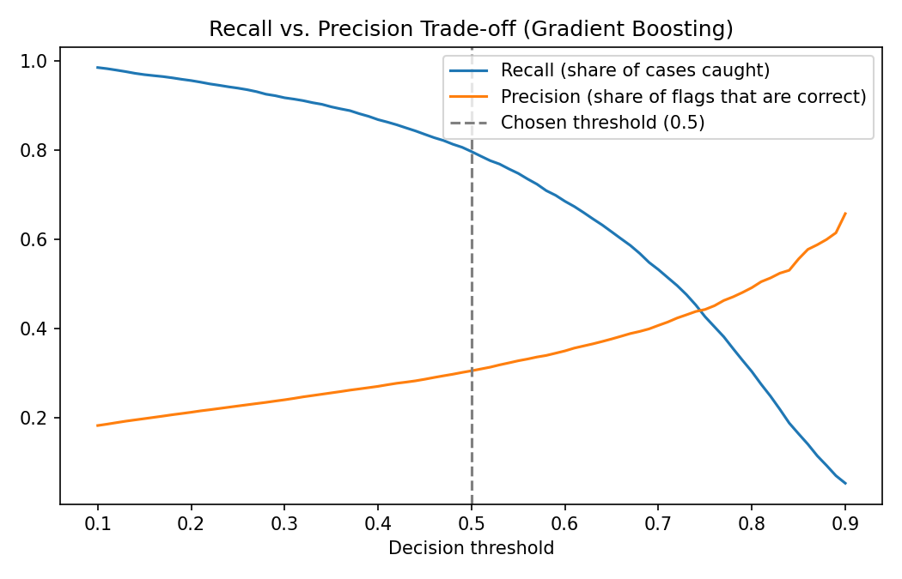

# Predicting Diabetes Risk from CDC Health Survey Data

Using **253,680 responses** from the CDC's 2015 Behavioral Risk Factor Surveillance System (BRFSS), this project explores which health indicators are linked to diabetes and builds models that flag people at risk of diabetes or prediabetes.

**Result:** a gradient boosting model reached an **ROC-AUC of 0.83** on held-out data and, at the chosen threshold, catches **80% of diabetes cases**, with flagged people **2.2× more likely** to have diabetes than average.

## Key findings

- **Accuracy is misleading here.** Only 13.9% of respondents have diabetes or prediabetes, so a model that always predicts "no" scores 86% accuracy while catching zero cases. Models are evaluated on recall, precision, and ROC-AUC instead.
- **The top predictors are self-rated general health, BMI, age, high blood pressure, and high cholesterol.** These match the patterns found in the SQL exploration before any modeling.
- **The simpler model is nearly as good.** Logistic regression (ROC-AUC 0.820) performs almost as well as gradient boosting (0.827), so for a screening tool where results must be explained, logistic regression is a strong choice.
- **The decision threshold is a deliberate trade-off.** At 0.5, the model catches 79.7% of cases with 30.5% precision, flagging 36% of people. Lowering it catches more cases but flags over half the population.

## Charts





## SQL exploration highlights (DuckDB)

| Group | Diabetes rate |
|---|---|
| Ages 18–24 vs. 70–74 | 1.4% vs. 21.8% |
| Healthy weight vs. obese | 5.7% vs. 23.4% |
| Neither high BP nor high cholesterol vs. both | 4.2% vs. 29.7% |
| Self-rated health "excellent" vs. "poor" | 2.5% vs. 37.9% |

## Approach

| Step | File | What it does |
|---|---|---|
| 1 | `01_get_data.py` | Downloads the dataset from the UCI Machine Learning Repository |
| 2 | `02_sql_exploration.py` | Explores diabetes rates across groups with SQL in DuckDB |
| 3 | `03_prep.py` | Checks data quality and creates a stratified 80/20 train/test split |
| 4 | `04_baseline_model.py` | Compares an always-"no" baseline with logistic regression |
| 5 | `05_compare_models.py` | Adds gradient boosting and tests decision thresholds |
| 6 | `06_explain_and_plot.py` | Ranks predictors with permutation importance and saves charts |

## Limitations

- **Survey data shows association, not causation.** All answers are self-reported.
- **Self-rated health may partly be an effect of diabetes**, since people who know they have it may rate their health lower.
- **`CholCheck` likely reflects healthcare access** (detection bias) rather than biological risk.
- **About 9.5% of rows are exact duplicates.** They were kept because different people can give identical answers on mostly yes/no questions, but matching rows across the train and test sets may slightly inflate test scores.
- **The data is from 2015**, so patterns may have shifted since.

## How to run

```bash
python3 -m venv .venv
source .venv/bin/activate
pip install -r requirements.txt
python3 01_get_data.py
python3 02_sql_exploration.py
python3 03_prep.py
python3 04_baseline_model.py
python3 05_compare_models.py
python3 06_explain_and_plot.py
```

## Tools

Python, SQL (DuckDB), pandas, scikit-learn, Matplotlib

## Data source

CDC Behavioral Risk Factor Surveillance System (2015), via the UCI Machine Learning Repository: *CDC Diabetes Health Indicators* (dataset 891).